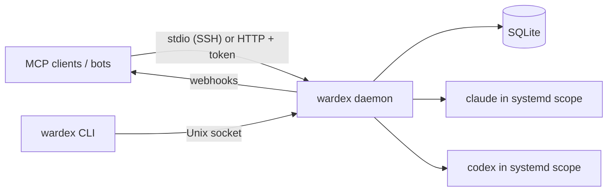

# Wardex

**One daemon for all your Claude Code and Codex sessions: start, watch, answer
and resume them from the CLI or from any MCP client.**

[](https://github.com/TNYCL/wardex/actions/workflows/ci.yml)
[](https://crates.io/crates/wardex)
[](https://github.com/TNYCL/wardex#license)
[](https://github.com/TNYCL/wardex/blob/main/Cargo.toml)

> **Status: early release (0.1).** Linux only. Interfaces, config and the
> database schema may still change between minor versions; see the
> [changelog](https://github.com/TNYCL/wardex/blob/main/CHANGELOG.md) before
> upgrading.

Wardex is a single Rust binary that runs
[Claude Code](https://docs.claude.com/en/docs/claude-code) and
[Codex](https://github.com/openai/codex) as managed sessions on one Linux
host. Instead of tmux panes and scraped terminal output, every session emits
structured events, keeps its state in SQLite, and can be driven by you, by
scripts, or by other agents over MCP. It is built for around 30 concurrent
agents on one machine and has been tested with 21 live sessions.

## Why

- **Bots can drive coding agents.** Every CLI capability is an MCP tool. A bot
  starts a session, gets a webhook when it asks a question, answers it, reads
  the result and sends the next instruction.
- **No terminal scraping.** Claude Code (stream-json control protocol) and
  Codex (`codex app-server` JSON-RPC) are mapped onto one event model.
- **Sessions outlive processes.** Daemon restarts, idle timeouts and memory
  pressure close processes, not work: `send` resumes the session with its
  context.

## Features

- **Claude Code and Codex drivers** behind one event model: `started`,
  `message`, `tool_call`, `question`, `approval`, `reminder`, `done`,
  `error`, `stuck`, `ended`, and more.
- **Questions as events.** When an agent asks something (Claude
  `AskUserQuestion`, Codex approvals), the question shows up in `pending` /
  `pending_questions` and is answered with `wardex answer` or the MCP `answer`
  tool.
- **Idle lifecycle.** An idle session closes after 12 h by default, earlier
  when more than 8 are idle or available memory drops below 1 GiB. Running
  turns and open questions are never closed. Every ended session records why
  (`ended_reason`), and `send` picks it up again.
- **Restart-safe.** State lives in SQLite. After a daemon restart, sessions
  are resumable, optionally automatically for those that were mid-turn.
  `wardex daemon restart --drain 600` waits for running turns first.
- **Adopt and fork terminal sessions** (opt-in). List Claude Code and Codex
  sessions you started outside Wardex, read their history, and continue them
  in Wardex (`adopt`) or branch off a copy while the original keeps running
  (`adopt --fork`). Wardex only reads the CLIs' own stores.
- **Many agents, one host.** Label sessions with `--agent` and `--task`,
  filter with globs, and send to the latest session of an agent without
  tracking ids.
- **systemd isolation.** Each session runs in its own transient
  `systemd-run --user` scope, optionally inside a slice, with per-session
  RSS/CPU in `status` and `overview`. The scope is cleaned up when the session
  ends, so no tool processes linger.
- **Git worktrees.** `--worktree NAME [--branch B]` runs a session in its own
  worktree; `summary` reports touched files, branch and uncommitted changes.
- **Stuck detection.** A reminder after 3 min on an unanswered question,
  `stuck` after 8 min of silence while no tool is running. All configurable.
- **Webhooks.** Important events are POSTed with retries and an optional
  HMAC-SHA256 signature, routed per agent and task, and reloaded without a
  restart.
- **MCP over stdio or HTTP.** `wardex mcp --stdio` (works over SSH, no token
  needed), or stateless Streamable HTTP at `/mcp` behind a bearer token, a
  Host header check and a rate limit on failed authentication.

## Requirements

- Linux with a systemd user manager. Run `loginctl enable-linger $USER` to keep
  the daemon running after logout. Scopes can be turned off with
  `resources.systemd_scope = false`.
- `claude` and/or `codex` installed and logged in. Tested with Claude Code
  2.1.302 and Codex 0.163.0 (see
  [`docs/drivers.md`](https://github.com/TNYCL/wardex/blob/main/docs/drivers.md)).
- Rust 1.88 or newer to build.

## Install

From crates.io:

```sh
cargo install wardex --locked
install -Dm755 ~/.cargo/bin/wardex ~/.local/bin/wardex
```

Or from source:

```sh
git clone https://github.com/TNYCL/wardex && cd wardex
cargo build --release --locked
install -Dm755 target/release/wardex ~/.local/bin/wardex
```

Run it as a systemd user service with the example config and unit from
[`deploy/`](https://github.com/TNYCL/wardex/tree/v0.1.0/deploy) (in a clone,
copy them from `deploy/` instead of downloading):

```sh
base=https://raw.githubusercontent.com/TNYCL/wardex/v0.1.0/deploy
mkdir -p ~/.config/wardex ~/.config/systemd/user
curl -fsSLo ~/.config/wardex/wardex.toml "$base/wardex.example.toml"
curl -fsSLo ~/.config/systemd/user/wardex.service "$base/wardex.service"
systemctl --user daemon-reload && systemctl --user enable --now wardex
loginctl enable-linger "$USER"
```

The unit runs `~/.local/bin/wardex`. Secrets such as `WARDEX_TOKEN` and webhook
URLs go into `~/.config/wardex/env` (mode 600), never into the config file.

## Quick start

```sh
id=$(wardex run --driver claude --cwd ~/src/myapp --agent me --task fix-tests \
  --prompt "Run the test suite and fix what fails")
wardex overview                 # everything at a glance
wardex tail "$id" -f            # follow it live
wardex pending                  # open questions
wardex answer "$id" "yes, use the existing fixture"
wardex summary "$id"            # result text, touched files, branch
wardex send "$id" "now write a short PR description"
```

`run` prints only the session id on stdout. Session ids can be shortened to any
unique prefix, and every command accepts `--json`.

## Connect an MCP client

**Same machine or over SSH (no token):**

```json
{
  "mcpServers": {
    "wardex": {
      "command": "ssh",
      "args": ["<host>", "~/.local/bin/wardex", "mcp", "--stdio"]
    }
  }
}
```

For a client on the same host, use `"command": "wardex"` with
`"args": ["mcp", "--stdio"]`.

**By URL (Streamable HTTP):** put `WARDEX_TOKEN=<token>` (for example from
`openssl rand -hex 32`) into `~/.config/wardex/env`, expose `127.0.0.1:7878`
through a tunnel
([`deploy/tunnel.md`](https://github.com/TNYCL/wardex/blob/main/deploy/tunnel.md))
and add the hostname to `http.allowed_hosts`:

```json
{
  "mcpServers": {
    "wardex": {
      "type": "http",
      "url": "https://<your-hostname>/mcp",
      "headers": { "Authorization": "Bearer ${WARDEX_TOKEN}" }
    }
  }
}
```

Wardex works with any MCP client (e.g. Claude Code) that can run a command
(stdio) or send a custom header (HTTP).

Give each bot or agent its own `agent` label so its sessions stay apart
(`list --agent`, `send --latest --agent`), and point a webhook at it so it
wakes up on `question`, `done`, `error` and `stuck` instead of polling.

### Prompt for your bot

> Wardex (MCP server `wardex`) runs Claude Code and Codex sessions for you.
> Start one with `run` (`driver` claude or codex, absolute `cwd`, `agent` set
> to your name and `task` to a short label). Sessions work on their own. When
> one asks a question it shows up in `pending_questions`; reply with `answer`.
> When a turn is done, read `summary` and continue with `send` if needed.
> Do not `stop` finished sessions; idle ones close on their own and `send`
> resumes them. `overview` shows all sessions. Do not start a second session
> for work that is already running.

The full tool reference and the bot loop are in
[`docs/mcp.md`](https://github.com/TNYCL/wardex/blob/main/docs/mcp.md).

## How it works



The daemon owns every agent process. Drivers translate each CLI's protocol
into events, which are stored in SQLite, streamed to `tail`, pushed to
webhooks and served over MCP. The CLI talks to the daemon over a Unix socket
(mode 0600).

## Safety

Wardex has no policy or approval layer. Sessions run with full permissions
(`bypassPermissions` / `danger-full-access`); `--readonly` is available per
session. Safety is left to your prompts and to `CLAUDE.md` / `AGENTS.md`
rules, so only run Wardex on hosts where that is acceptable. HTTP/MCP is never
served without a token; keep it on `127.0.0.1` and expose it only through a
tunnel.

## CLI reference

<details>
<summary>All commands</summary>

```text
wardex daemon                      # run the daemon (see deploy/wardex.service)
wardex daemon stop [--drain S]     # shut it down and wait; live sessions become resumable
wardex daemon restart [--drain S]  # same PID, current binary; sessions resume
wardex daemon reload               # re-read config + env file (webhooks), no restart
wardex run --driver claude|codex --prompt "..." [--prompt-file F|-]
           [--model M] [--reasoning R] [--cwd DIR] [--readonly]
           [--worktree NAME [--branch B] [--rm-worktree]]
           [--agent A] [--task T] [--slice S]
wardex list [-a] [--agent GLOB] [--task GLOB] [--ended] [--resumable]
wardex status <id> | summary <id> | pending
wardex tail <id> [-f] [-n N] [--since-seq N [--wait SECS]] [--deltas] [--full]
wardex tool-output <id> <seq>      # full input/output of one tool call
wardex answer <id> <text> | answer <id> --item ID=TEXT ... [--question Q]
wardex send <id> <message> | interrupt <id> | stop <id> | resume <id> [message]
wardex send --latest --agent GLOB [--task GLOB] <message>   # newest matching session
wardex overview [-n EVENTS]        # live sessions, questions, resources at a glance
wardex mcp --stdio                 # MCP server on stdin/stdout (e.g. over ssh)
wardex external list [--cwd DIR [--under] | --here]   # sessions started outside Wardex
wardex history <id> [--turns N] [--format text|markdown|json]  # native conversation
wardex adopt <id> [--fork] [--readonly] [--message TEXT] [--force]  # continue it in Wardex
wardex run --fork-from <id> --prompt "..."                     # fork it and continue
```

The MCP tools mirror these: `run`, `overview`, `list`, `status`, `tail`,
`summary`, `pending_questions`, `answer`, `send`, `interrupt`, `stop`,
`resume`, `tool_output`, plus `external_list`, `history` and `adopt` when
`[external]` enables them.

</details>

## Docs

- [Scope and roadmap](https://github.com/TNYCL/wardex/blob/main/docs/SCOPE.md)
- [MCP tools and the bot loop](https://github.com/TNYCL/wardex/blob/main/docs/mcp.md)
- [Webhooks](https://github.com/TNYCL/wardex/blob/main/docs/webhooks.md)
- [External sessions (adopt and fork)](https://github.com/TNYCL/wardex/blob/main/docs/external-sessions.md)
- [Drivers and tested CLI versions](https://github.com/TNYCL/wardex/blob/main/docs/drivers.md)
- [Exposing MCP through a tunnel](https://github.com/TNYCL/wardex/blob/main/deploy/tunnel.md)
- [Example config](https://github.com/TNYCL/wardex/blob/main/deploy/wardex.example.toml)

## Contributing

See [`AGENTS.md`](https://github.com/TNYCL/wardex/blob/main/AGENTS.md). Pull
requests go against `main`; CI runs fmt, clippy, tests and a secret scan.

## License

Licensed under either of

- Apache License, Version 2.0
  ([LICENSE-APACHE](https://github.com/TNYCL/wardex/blob/main/LICENSE-APACHE))
- MIT license ([LICENSE-MIT](https://github.com/TNYCL/wardex/blob/main/LICENSE-MIT))

at your option.

Unless you explicitly state otherwise, any contribution intentionally submitted
for inclusion in the work by you, as defined in the Apache-2.0 license, shall be
dual licensed as above, without any additional terms or conditions.
